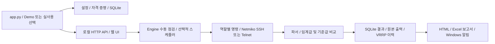

# Netcheck Center 분석 및 독립 이전

검토일: 2026-10-22. 원본은 `yejin0414/test_auto`의
`67445ed5646e699c34fcdd87b3275ed7dee6bfb1`입니다. 원본에는 커밋/Push하지 않았습니다.
대상은 `yejin0414/auto_network`이며 원본 Git 이력 없이 검토된 파일로 시작합니다.

## 실행 구조

- `app.py`는 설정·저장소·Engine을 구성합니다. `--demo`는 `DemoWorld`를 사용하며 실제 장비에 접속하지 않습니다.
- `nc/commands.py`는 BB(Comware), MM 및 WLC(ArubaOS 8) 명령과 대체 명령을 정의합니다.
  `nc/collector.py`는 Netmiko 연결, 인증 오류 구분, 명령 응답 및 연결 종료를 처리합니다.
- `nc/engine.py`는 장비 병렬 수집, 클러스터 대표 선택, 기준값·변화 이력·보관 기간을 관리합니다.
  스케줄은 프로세스 내부 스레드와 선택적인 Windows 작업 스케줄러로 나뉩니다.
- `nc/parsers.py`와 `nc/evaluate.py`는 CPU/메모리, 슬롯·전원·팬, 인터페이스, LACP,
  OSPF, VRRP, MM 상태, WLC 멤버십·Client 분배를 해석합니다. 정상/주의/장애/확인 불가를 구분합니다.
- `nc/server.py`는 루프백 HTTP 서버와 토큰 인증 API를 제공합니다. 웹은 외부 CDN 없이 동작하는 HTML/CSS/JS입니다.
- `nc/store.py`는 SQLite에 점검 회차, 결과, 압축 원본 응답, 기준값, 이벤트, VRRP 이력을 저장합니다.
  WAL reset 수정 버전은 WAL, 그 밖의 런타임은 rollback journal(`DELETE`)을 사용합니다.
  SQL 값은 바인딩되며 쓰기에는 잠금과 트랜잭션을 사용합니다.
- `nc/report.py`는 HTML, `nc/excel.py`는 Excel을 만듭니다. `appwindow`, `instance`, `wintask`,
  `credentials`, `notify`는 Windows 창·중복 실행·예약작업·자격 증명·알림을 담당합니다.

## 기능별 판정

여기서 **정상**은 코드 검토와 명시한 Demo/fixture/Mock 테스트 범위의 판정입니다.
실제 운영 장비나 회사망에서의 정상 동작을 의미하지 않습니다.

| 기능 | 원본 판정 | 이전본 처리 및 근거 |
|---|---|---|
| Python 구성·실행 흐름 | 정상 / 개선 필요 | 모듈 분리와 실행 흐름 유지. 1회 점검 실패 종료코드 수정 |
| Comware SSH/Telnet | 정상 / 추가 검증 필요 | 루프백 Mock의 실제 Netmiko 경로 유지. 펌웨어별 실장비는 미실행 |
| Aruba MM/WLC SSH | 정상 / 오류 가능성 | CPU·메모리·클러스터 fixture 유지, 수집 누락의 정상 오판 수정 |
| 명령 안전성 | 오류 가능성 P1 | 추가 명령 입력과 실행 직전 모두 조회 명령 검사 |
| 파싱·상태·임계값 | 오류 가능성 P1 | 0 메모리, 불명 전원 상태, NaN/무한대/범위 오류 처리 |
| 웹 UI/API | 정상 / 개선 필요 | 구성도·이력·설정·콘솔 유지. 요청 길이 오류 방어, 예시 IP 교체. 접근성·모바일 E2E 후속 |
| SQLite·HTML 보고서 | 정상 / 추가 검증 필요 | 기존 저장·이력·VRRP 테스트 유지. 장기 DB 크기·장애복구 후속 |
| Excel 보고서 | 오류 가능성 P1/P2 | 수식 주입 방어, 미확인 지표 정상 표시 수정, 회차별 파일명 |
| 자동 스케줄러 | 개선 필요 P1 | 신규 설정 기본 꺼짐, 원본과 작업 이름 분리. 사용자가 켠 경우 기능 유지 |
| 테스트·Actions·EXE | 개선 필요 | macOS와 Windows 결과 구분, Windows 3.12 러너 유지, 자동 Release 제거 |

## 재현한 문제와 수정

P1은 잘못된 명령·상태 판정 또는 원본 환경에 영향을 줄 수 있는 문제,
P2는 운영 편의·진단·일부 이력 정확성 문제입니다. 재현에는 순수 함수, Mock 또는 폐기 가능한 CI만 사용했습니다.

| ID / 우선순위 | 원본 재현 및 영향 | 수정 / 회귀 검증 |
|---|---|---|
| F01 P1 | `extra_commands.BB`에 `reboot` 또는 개행을 넣으면 `validate`와 `commands_for`를 통과. 자동 점검 경로가 설정 명령을 전송할 수 있음 | `config`, `commands`, `collector.run_spec`에서 공통 검사. 제어문자·리디렉션·비조회 파이프 차단. Mock의 `session.run` 미호출 확인 |
| F02 P1 | 원본/대상 모두 `NetcheckCenter` 계정 서비스·인스턴스와 같은 예약작업 사용. 실행만으로 기존 설정 덮어쓰기·종료 가능 | 서비스/상태 `AutoNetwork.NetcheckCenter`, 작업 `AutoNetwork NetcheckCenter AutoCheck`, 포트 8875/8876. 원본 앱을 인식해 강제 종료하는 경로 제거 |
| F03 P1 | Demo/단위테스트의 `CredentialStore.set(..., remember=False)`가 OS 저장 계정 삭제 경로에 진입 | `persistent=False`에서 OS keyring 발견·읽기·쓰기·삭제 모두 금지. Demo/일반 테스트에 적용 |
| F04 P1 | WLC CPU/메모리 성공, membership/load 실패 시 검사를 생략하여 정상 가능 | 누락·실패·해석 불가 및 상태 없는 멤버는 `unknown`. 정상 fixture도 별도 보존 검증 |
| F05 P1 | `Slot Total Free\n1 0 0` 메모리 출력에서 TypeError로 회차 실패 | 0/불합리/비유한 수치를 제외하고 값이 없으면 확인 불가. 정상 슬롯은 유지 |
| F06 P1 | `cpu_warn=NaN` 등은 float 변환만 통과해 비교가 무효화됨 | 유한값·0~100·주의<장애 및 Client 최소 수 정수 검증 |
| F07 P1 | 장비명·응답 `=1+1`을 Excel에 넣으면 수식 셀로 저장 | 외부 문자열을 명시적 문자열 셀로 저장. 다시 로드해 수식이 아님을 확인 |
| F08 P1 | Excel 컨트롤러 시트에서 CPU/메모리 없는 항목을 정상으로 표시 | 누락 지표 `unknown` 처리 |
| F09 P2 | SSH 배너 직후 EOF에서 빈 recv를 반복하여 접속 진단 종료 안 됨 | EOF·짧은 KEXINIT·비정상 길이 검사, 소켓 종료 확인 |
| F10 P2 | 전원 `Off`/`NotSupply`를 정상·미장착으로 설명 | 제조사 의미를 임의로 단정하지 않고 `unknown` 및 원문 제공 |
| F11 P2 | 같은 분에 2회 보고서를 만들면 파일명이 같아 덮어씀 | 초와 회차 ID를 파일명에 포함 |
| F12 P2 | `_after_run`의 Excel 저장 오류를 즉시 빈 문자열로 덮어씀 | 보고서 처리 전에 이전 오류를 지워 새 실패가 화면에 남음 |
| F13 P2 | `--check-once`가 실패해도 exit 0, 이전 회차를 출력할 수 있음 | 실패 시 exit 1, 반환된 회차가 있을 때만 결과 조회 |
| F14 P1 | 원본 CI는 main Push마다 contents:write로 Release 생성·덮어쓰기 | 읽기 권한 CI와 검증 artifact만 유지. Release 명령 및 태그 생성 없음 |
| F15 P2 | 소스의 배치 파일 4개에 실제 개행 대신 문자 `\\r\\n` 포함 | CRLF로 복구, Git 속성에 배치 CRLF 명시 |
| F16 P2 | 배포 루트로 복사한 autostart 스크립트가 상위 폴더를 앱 위치로 계산 | 소스 tools/와 배포 루트 모두 식별. Windows 실제 바로가기 경로 테스트 |
| F17 P2 | HTTP Content-Length 음수/문자 입력 시 요청이 잘못 처리됨 | 400 응답, 과대 요청 413 유지 |
| F18 P2 | 같은 VRID를 다른 VLAN에서 사용하면 다른 인터페이스·이전 역할·과거 시각의 로그를 점검 변화에 연결 | 정규화한 인터페이스/VRID와 이전·새 역할을 비교. 직전 점검 완료~현재 시작 구간의 유일한 로그만 연결하고, 모호한 로그는 별도 보존 |
| F19 P2 | 기준에 있던 VRRP 그룹이 일부/전체 사라져도 정상 가능 | 소실은 장애, 명령 실패·해석 불가·불완전 출력은 확인 불가. 기존 기준을 자동으로 덮어쓰지 않음 |
| F20 P2 | 임계값 변경 후 과거 Excel 재생성 시 요약과 상세 판단이 달라짐 | 회차별 사업장명·6개 임계값·형식/평가 버전 저장. 기존 DB 확장, HTML/Excel 공통 적용. 스냅샷 없는 회차는 저장된 판정을 사용하고 기준 부재 표시 |
| F21 P2 | 대표 WLC의 membership만 성공하면 load를 얻을 수 있는 대체 WLC를 시도하지 않음. 대체 접속·명령·종료가 멈추면 제한 없이 대기 가능 | 성공 항목 보존, 부족한 명령만 같은 클러스터에서 재시도. 대체 단계 전체 300초 예산과 취소 감독, 명령별 출처 및 원본 저장 |
| F22 P2 | 활성화 작업을 지연시킨 뒤 비활성화 설정을 저장하면, 오래된 활성화 작업이 나중에 끝나 작업/표시 상태가 뒤집힘 | 단일 worker가 현재 저장된 설정을 읽고 직렬 적용. 이전 결과 표시 차단, 실패 재시도, 종료 시 마지막 설정 반영 |
| F23 P2 | 내부 scheduler가 대기 중 설정 변경으로 깨어나도 대기 전 주기로 다음 시각을 계산하고 신호를 지움 | 다음 단계에서 최신 설정 재조회, 변경된 주기/정렬/활성 장비 확인, 이미 도래한 점검도 변경 신호가 있으면 재판단 |
| F24 P2 | Windows CI의 독립 DB 동시 열기에서 초기 스키마 준비가 `database is locked`로 실패하고 연결이 남아 임시 DB 삭제도 실패 | WAL 준비와 스키마 변경을 분리하고 초기화 잠금 충돌만 제한 시간 내 재시도. 스키마 변경은 쓰기 트랜잭션으로 묶고 실패한 연결은 닫음 |
| F25 P2 | UI에서 새 계정을 저장한 뒤 잘못된 임계값/주기로 설정 저장이 실패하면 계정만 변경됨. PC 계정 삭제 오류를 무시해 재시작 후 계정이 다시 나타날 수 있음 | 단일 설정·계정 API에서 전체 검증 후 저장. 파일 저장 실패 시 PC 계정 복구, 저장/삭제/복구 실패 명시. 기존 API도 같은 직렬화·종료 차단 적용 |
| F26 P2 | 슬롯/LACP/전원/팬의 해석 불가·부분 출력이 검사에서 빠지거나 정상으로 표시됨. OSPF 해석 실패는 인접 전체 소실로 오판 가능 | 명시된 빈 구성과 미해석을 구분. 미해석은 확인 불가·원본 보존·기준값 유지. 읽힌 장애 증거는 유지하며 불완전 출력으로 누락을 추정하지 않음 |
| F27 P2 | 장비를 삭제해도 기준값이 남고, 삭제 전 시작한 점검이 기준값을 다시 쓸 수 있음. 같은 ID 재추가/주소 변경 시 이전 상태와 비교 | 현재 장비 목록과 기준값 동기화, 설정에 장비별 수명 식별값 저장, DB revision으로 오래된 회차의 기준값 갱신 차단. 과거 이력은 보존 |
| F28 P1 | 회차 저장 후 기준값/이벤트/VRRP가 각각 확정되어 중간 DB 실패 시 일부만 남음. 보관 정리 실패가 성공한 점검을 실패로 표시 | 전체 점검 데이터를 단일 트랜잭션으로 저장. 저장 실패 rollback과 저장 후 백업/보관 정리 경고를 구분. 읽기 실패도 빈 이력으로 위장하지 않음 |
| F29 P2 | 온라인 백업 및 검증된 복원 경로 없음. WAL 사용 중 DB 파일만 복사하면 최신 확정 내용이 빠질 수 있음 | SQLite online backup, 무결성/스키마 확인, 새 경로에만 확정, 24시간 자동/수동 백업과 최근 7개 보관, 별도 새 파일 복원/검증 명령 |
| F30 P1 | Windows Python 3.12.10의 SQLite 3.49.1은 WAL reset 손상 문제 미수정. 여러 연결에서 checkpoint/write가 겹칠 때 손상 가능 | 수정이 확인된 SQLite만 WAL 허용. 나머지는 DELETE로 전환 후 실효 모드를 확인하고, 전환 실패는 시작 중단. 버전 경계·기존 WAL 전환·잠금 실패·Windows EXE 실제 모드 검증 |
| F31 P2 | 100만 장비 결과에서 최신 uptime 조회가 10초 제한 초과, VRRP 조회도 전체 정렬/탐색 | 유효 uptime·회차 시간·VRRP 순서/중복/미확인 인덱스와 조회 변경. 결과·보관 의미 및 실행량 회귀 확인. 인덱스의 공간/삭제 비용은 별도 기록 |
| F32 P2 | 백업 전체 복사와 검증이 화면 상태·설정 잠금까지 점유 | 별도 읽기 전용 SQLite 연결로 온라인 백업, API 잠금은 요청 승인에 한정. 복사/검증 진행 중 조회·원자 저장·상태/종료 응답 회귀 |
| F33 P2 | 외부 복사본이 유효 SQLite이면서 내부 값만 바뀐 경우 구조 검사로 감지 불가 | DB와 SHA-256·크기를 단일 .ncbak 패키지로 전송. 복사본 검증 후 원본 없이 복원, 잘림·변조·전송 실패·공간 부족 모의 |
| F34 P2 | 하드링크 미지원 저장소에서 파일 확정 실패 | 명확한 미지원 오류일 때 Windows/macOS native 독점 이름 변경. 기존 대상·경쟁 파일을 보존하며 안전한 방식이 없으면 실패 |

주요 회귀 테스트: `tests/test_collection_regressions.py`, `tests/test_app_regressions.py`,
`tests/test_windows_build_tools.py`. 기존 E2E는 실제 Netmiko로 루프백 SSH/Telnet Mock에 연결합니다.

## 이전·보안 점검

- 원본 `.git`을 복사하지 않고 소스 스냅샷을 새 저장소로 초기화했습니다. 원본 출처·저작권은 `UPSTREAM.md` 및 기존 파일에 보존합니다.
- 원본 `release/netcheck_center_source.zip`은 중복/중첩 파일 및 미검토 데이터 반입을 막기 위해 제외했습니다.
- 운영 `config/config.json`, DB, 실행 로그, 보고서, 비밀키, 환경 파일은 이전 대상에서 제외하고 `.gitignore`를 보강했습니다.
- Demo·fixture·UI에 남은 사설 IPv4 예시를 문서용 주소로 교체했습니다. 장비명은 BB/MM/WLC 등 일반 예시입니다.
  OSPF Area ID와 펌웨어 버전은 주소로 오인하지 않았습니다. Mock 계정 `op/pw`, `demo/demo`는 테스트 전용입니다.
- Gitleaks 8.30.1로 스냅샷의 알려진 비밀값 패턴을 검사합니다. `tools/check_snapshot.py`는 추적 파일의 운영 데이터·비밀 파일·사설 주소·예상 밖 바이너리를 거부하며 CI에도 적용합니다.
- README의 소스·CI·릴리스 주소는 대상 저장소로 변경했습니다. 아직 게시하지 않은 EXE Release를 다운로드 가능하다고 표시하지 않습니다.
- 대상 Push 권한과 빈 refs를 조회했고 업로드 직전 다시 확인합니다. Force Push는 사용하지 않습니다.
- Windows 전용 통합 테스트는 `NC_WINDOWS_TESTS_DISPOSABLE=1`인 폐기 가능한 러너에서만 실행합니다. 로컬 Mac에서는 예약작업·실장비를 실행하지 않았습니다.

## 검증 기록

기본 명령: `python -m unittest discover -s tests -t . -v`

| 검사 | 상태 / 범위 |
|---|---|
| 원본 스냅샷 기준 테스트 | PASS — macOS, Python 3.12.14, 55개, 113.345초. 별도 baseline 디렉터리와 OS keyring 없는 venv |
| 이전본 전체 테스트 | PASS — macOS Python 3.12.14, 92개 실행: 90개 통과, Windows 전용 2개 미실행, 113.876초 |
| Gitleaks / 소스 파일 검사 | PASS — Gitleaks 8.30.1 비밀값 패턴 발견 0건; 추적 파일 검사 통과 (업로드 직전 재검사) |
| Windows unittest / EXE / 창 / 자격 증명 / 작업 스케줄러 | 대상 저장소에 올라간 정확한 SHA의 Actions 성공으로만 판정. 최초 커밋 작성 시에는 NOT_RUN |
| 실제 장비·회사망·관리자 설치·재부팅·장기 운영 | NOT_RUN — 사용자 요청에 따라 실제 장비 접속·설정 변경 금지 |

원본 SHA의 Windows CI 성공은 참고 이력이며 **수정한 대상의 Windows 검증을 대신하지 않습니다**.
최초 대상 CI [39743482500](https://github.com/yejin0414/auto_network/actions/runs/39743482500)는
92개 중 91개 통과, 1개 실패했습니다. 자동 시작 경로 테스트가 Windows의 `RUNNER~1` 별칭과
긴 경로를 문자열로 비교한 문제였으며, 파일/디렉터리 실제 동일성 검사로 수정했습니다.
초기 실패 실행은 EXE 빌드와 배포를 진행하지 않았습니다. 수정은 별도 브랜치와 PR로 관리합니다.
대상 결과는 [Windows Actions](https://github.com/yejin0414/auto_network/actions/workflows/build-exe.yml)에서 확인합니다.
Windows CI는 원래의 `windows-latest` / Python `3.12`를 유지하며 공개 Release를 만들지 않습니다.

## VRRP·과거 보고서 후속 수정

F18~F20은 독립 브랜치의 PR에서 검증합니다. 이전 완료 기준인 main `15ab44f`의
[Windows 실행 39745046255](https://github.com/yejin0414/auto_network/actions/runs/39745046255)는
92개 단위·통합 테스트와 EXE 검증을 통과했습니다. 후속 변경은 해당 PR의 새 Windows 결과로 판단합니다.

후속 수정 로컬 검증: macOS/Python 3.12.14 전체 129개 중 127개 통과,
Windows 전용 2개 미실행(113.588초). Gitleaks 8.30.1 발견 0건,
추적 파일 87개 스냅샷 검사와 `git diff --check` 통과. Windows 결과는 이 PR의 Actions 체크를 따릅니다.

- `tests/test_vrrp_accuracy.py`: 같은 VRID의 다른 VLAN, 인터페이스 별칭, 이전/새 역할,
  과거·미래·불명·다중 전환 로그와 그룹 소실/해석 실패를 재현합니다. 개별 명령 관측 시각은
  저장하지 않으므로 로그 연결 범위를 직전 점검 완료 후~현재 점검 시작까지로 제한합니다.
  점검 실행 중 발생한 변화나 장비 시계 오차는 정확히 확정하지 않으며 로그를 별도로 보존합니다.
- `tests/test_report_snapshots.py`: 기존 SQLite 반복/동시 초기화와 중단된 스키마 변경,
  재시작 후 설정 보존, HTML·Excel 다운로드/저장/열기/자동 저장을 검증합니다.
- `tests/test_report_capture.py`: 수집 중 설정을 변경해도 평가와 보고서가 시작 당시 설정을
  함께 사용함을 Demo로 확인합니다. 설정 전체·계정·장비 접속정보는 새 메타데이터에 넣지 않습니다.

기존 회차의 원래 임계값은 복원할 수 없으므로 현재 값을 소급 저장하지 않습니다.
기준이 없거나 지원하지 않는 형식은 저장된 CPU·메모리 판정을 표시하고 ‘당시 판단 기준 없음’을 명시합니다.
이때 슬롯별 과거 판정은 따로 저장돼 있지 않아 장비 단위 결과를 사용하며, 사업장명은 현재 설정 참고값으로 표시합니다.
새 회차는 사업장명·6개 임계값과 형식/평가 버전만 `runs.report_context`에 저장합니다.

## 클러스터 대체 수집·스케줄 동기화 후속 수정

F21~F24는 main `9b27a20` 이후 별도 PR로 검증합니다. 해당 기준 커밋의
[Windows 실행 39748659883](https://github.com/yejin0414/auto_network/actions/runs/39748659883)은
129개 테스트와 EXE 검증을 통과했습니다. 이번 변경은 새 PR의 Windows 결과로 판단합니다.

- 대체 수집은 멤버십/Client 분배별 성공 결과를 유지하고 실제 응답 장비를 기록합니다.
  연결된 다른 클러스터 장비의 결과는 사용하지 않습니다. 미해석 출력은 대체 수집 대상이지만,
  읽힌 DISCONNECTED·멤버 누락 등 장애 증거를 다른 정상 출력으로 덮지는 않습니다.
- 모든 대체 시도에 하나의 300초 예산을 공유합니다. 접속/명령/종료 중 대기와 점검 취소를
  감독하고 이미 끝난 명령 결과만 회수합니다. 늦게 반환한 작업은 현재 회차·진행 상태를 변경하지 않습니다.
  `tests/test_cluster_fallback.py`의 Mock으로 부분 성공, 시간 제한, 취소와 출처를 검증합니다.
- `nc/schedule_sync.py`의 단일 worker는 알림에 담긴 옛 설정 대신 현재 설정을 읽습니다.
  실패는 화면에 표시하고 5초부터 최대 60초 간격으로 재시도하며 새 저장이 있으면 즉시 재확인합니다.
  Windows 작업 적용 한 번에 30초 예산을 공유하고, 종료 시 새 설정 저장을 막은 뒤 최대 65초 동안
  마지막 설정을 반영합니다. 실패/시간 초과는 로그와 종료코드 1로 남깁니다.
- `tests/test_schedule_sync.py`는 Event로 작업 순서를 제어하여 역순 완료·오래된 알림·재시도·종료를
  검증합니다. `tests/test_scheduler_refresh.py`는 내부 scheduler의 대기 중 설정 변경을 검증합니다.
- 웹 원본 링크와 HTML/Excel은 명령과 실제 수집 장비를 함께 보여 줍니다.
  `tests/test_cluster_source_reports.py`는 서로 다른 WLC 출처가 보고서에서도 유지되는지 검증합니다.
- 기존 Windows 통합 스크립트에 주기 연속 저장 → 마지막 끄기 → 즉시 종료 후 예약작업 부재 검사를
  추가했습니다. 실제 실행은 폐기 가능한 GitHub Actions Windows 러너에서만 수행합니다.

로컬 검증: macOS Python 3.12.14에서 `python -m unittest discover -s tests -t . -v`로
182개 실행, 180개 통과·Windows 전용 2개 건너뜀·실패 0개(114.415초).
신규 회귀 53개를 포함하며 기존 Mock SSH/Telnet은 루프백만 사용했습니다.
JavaScript 문법 및 명령별 원본 링크/오래된 응답 방지 검사는 통과했습니다.
추적 파일 92개 스냅샷 검사와 Gitleaks v8.30.1에서 운영 데이터·사설 IP·비밀정보 발견은 없었습니다.
Windows 테스트·EXE·예약 작업 검증 결과는 이 변경 PR과 병합 커밋의 Actions 실행에 기록합니다.
첫 Windows 실행에서는 테스트의 epoch 부근 날짜 변환과 소수점 시간 상한 가정으로 2개가 실패했습니다.
날짜 기준을 지원 범위 안으로 이동하고 epoch 변환의 정확한 표현값을 검증하도록 테스트를 수정했습니다.
실제 monotonic 제한 시간·중단·늦은 응답 차단 검증은 유지했습니다.
다음 Windows 실행에서 이 시간 테스트는 통과했으나 기존 DB 동시 열기 검사가 잠금 충돌로 실패했습니다.
F24는 이 실행에서 확인된 초기화 문제를 수정하며, 실패 연결 정리와 제한된 재시도를 회귀 검사합니다.
WAL 준비와 스키마 변경을 분리하고 DDL·마이그레이션을 한 트랜잭션으로 처리합니다.
잠금 재시도 예산은 총 30초이며, 다른 초기화 오류는 즉시 연결을 닫고 전달합니다.
신규·기존 DB의 동시 열기 30회 반복 검사와 잠금/복구/실패 연결 정리 검사를 통과했습니다.
실제 장비, 일반 사용자 PC, 실제 예약 시각에 의한 장기 실행은 이번 로컬 검증 범위가 아닙니다.

## 계정·설정 저장과 선택 명령 해석 후속 수정

F25~F26은 main `7c241f0` 이후 별도 PR에서 검증합니다.

- `POST /api/settings`는 설정과 공통 계정 변경을 한 요청으로 검증·저장합니다.
  기존 `/api/config`, `/api/credentials`도 지원하며 동시 저장과 종료 중 저장을 직렬화/차단합니다.
  API 상태 응답은 설정과 계정 상태를 같은 잠금 안에서 읽고 비밀번호는 반환하지 않습니다.
- 키링의 이전 값을 복구할 수 있도록 보관한 뒤 설정 파일을 원자적으로 교체합니다.
  파일 저장 실패 시 이전 계정을 복구하고 메모리 설정/계정은 성공 후 반영합니다.
  저장·삭제·복구 실패는 일반 오류 메시지로 남기며 비밀번호나 백엔드 예외 본문을 노출하지 않습니다.
  비밀번호/토큰을 설정 필드에 넣는 요청도 거부합니다.
- OS 자격 증명 저장소와 파일 시스템은 하나의 트랜잭션을 제공하지 않습니다.
  두 저장소 사이에서 프로세스가 강제 종료되거나 OS 저장소의 복구가 실패한 경우까지
  원자성을 보장하지는 않습니다. 복구 실패는 별도 상태로 표시하고 계정 재설정을 안내합니다.
- 슬롯·LACP·전원·팬·OSPF는 완전한 관측, 명시된 빈 구성, 해석 불가를 구분합니다.
  빈 응답/헤더만 있는 출력/잘린 행/모순된 수치/알 수 없는 상태는 정상으로 추정하지 않습니다.
  불완전 출력에서는 기준값을 갱신하거나 빠진 항목을 장애로 추정하지 않습니다.
  명시적으로 읽힌 장애는 부분 해석 설명과 함께 유지합니다. 로그와 추가 명령의 참고용 계약은 유지합니다.
- `tests/test_optional_reports.py`는 수집 결과 → SQLite 재열기 → HTML/Excel에서도
  확인 불가와 원본 출력이 유지되며 기존 기준값을 바꾸지 않는지 검증합니다.
  수정 전 같은 재현은 OSPF 해석 실패를 전체 소실로 보아 `crit`가 되는 것을 확인했습니다.
- Windows EXE 검사에는 설정 검증 실패, 설정 파일 교체 실패, 기존 계정 복구와 재시작 후
  Mock SSH 접속을 포함합니다. Windows 자격 증명 저장소는 폐기 가능한 CI 러너에서만 사용합니다.

로컬 회귀 결과: `python -m unittest discover -s tests -t . -v`는 225개 중 223개 통과,
Windows 전용 2개 건너뜀(114.861초)입니다. 신규 Python 회귀는 계정/설정 17개,
선택 명령 25개, SQLite/보고서 1개입니다. Node UI 검증도 통과했습니다.
추적 소스 98개 스냅샷 검사와 Gitleaks v8.30.1 검사에서 운영 데이터·비밀값 탐지 0건입니다.
Windows 성공 여부는 이 변경의 PR 및 main Actions 실행 결과에서 별도로 확인합니다.

파서의 미구성·부분 출력 회귀 자료는 합성 fixture이며 모든 Comware 펌웨어의 실장비 출력 증거가 아닙니다.
일반 상태/출력 형식은 [H3C OSPF 명령 문서](https://www.h3c.com/en/d_201909/1227470_294551_0.htm)와
[팬/전원 상태 문서](https://www.h3c.com/en/d_202108/1449292_294551_0.htm)도 참고했습니다.
실장비·일반 사용자 PC·장기 예약 실행은 별도 검증 범위로 남깁니다.

## 장비 기준값 수명과 DB 장애·백업 후속 수정

F27~F30은 main `9fb5254` 이후 별도 PR에서 검증합니다.

- 삭제·접속 대상/역할/클러스터 변경 때 해당 장비 기준값을 정리합니다. 비활성화·이름·대표 표시 변경은 유지합니다.
  WLC IP 연결형태 기준도 현재 목록에 맞춥니다. 과거 회차/원본/이벤트/VRRP 기록은 보존합니다.
- 설정 파일의 `_baseline_epochs`와 `_baseline_identities`는 앱이 관리합니다. 삭제 후 동일 ID를 다시 추가하면 새 값이 생겨,
  DB 정리가 실패한 동안 발생한 삭제/재추가도 재시작 후 감지합니다. 클라이언트가 보낸 식별값으로 덮어쓰지 않습니다.
  이력 비교도 장비 수명을 확인해 재추가한 장비를 이전 장비의 uptime/VRRP와 비교하지 않습니다.
- 점검 시작 때 기준값과 DB revision을 읽습니다. 저장 전에 현재 설정을 다시 동기화하고 revision이 달라졌으면
  역사적 관측은 저장하되 그 회차의 기준값 갱신은 건너뜁니다. 수동 기준값 초기화·VRRP 확인도 revision을 바꿉니다.
- 회차/장비 결과/압축 원본/기준값/이벤트/VRRP는 단일 트랜잭션입니다. 실제 SQLite FULL, READONLY, BUSY,
  LOCKED 오류와 CORRUPT/NOTADB 거부를 임시 파일로 검증합니다. 실제 디스크를 채우거나 운영 DB를 손상시키지 않습니다.
- 백업은 온라인 backup API와 제한 시간을 사용하고, 임시 파일 검증 후 기존 대상을 덮어쓰지 않는 방식으로 확정합니다.
  최근 24시간 이내 검증된 관리 백업을 재사용하거나 새로 만들고 최근 7개만 유지합니다.
  백업 실패 때 보관 기간 정리를 건너뛰며, 이미 저장한 회차는 성공으로 유지하고 경고를 표시합니다.
- `--verify-db`, `--restore-db ... --restore-to ...`는 계정/장비/스케줄러를 초기화하기 전에 실행·종료합니다.
  복원은 기존 DB 및 WAL/SHM 파일이 없는 새 경로만 허용하며 원본은 보존합니다.
- Windows EXE 회귀에는 백업 API → EXE 검증/새 파일 복원 → 덮어쓰기 거부, 장비 삭제 후 기준값 정리와
  과거 회차/원본 보존을 포함합니다. 기존 Mock SSH/Telnet·계정·창·작업 스케줄러 검사도 유지합니다.
- 첫 Windows CI는 283개 검사와 EXE 검증을 모두 통과했지만, 로그에서 SQLite 3.49.1을 확인했습니다.
  [SQLite 공식 WAL reset 설명](https://www.sqlite.org/wal.html#the_wal_reset_bug)에 따라
  3.51.3 이상 및 3.50.7+/3.44.6+ 해당 유지보수 계열만 WAL을 사용하고 나머지는 DELETE로 선택합니다.
  원자 트랜잭션 자체가 SQLite 내부 버그를 해결하는 것은 아닙니다. 같은 DB의 여러 쓰기 연결은
  앱의 객체별 잠금 밖에서도 생길 수 있으므로 실제 저널 모드를 확인하며, 실패하면 연결을 닫습니다.

macOS 최종 전체 단위·통합 검사는 289개 중 287개 통과, Windows 전용 2개 건너뜀이며 UI 저장/백업 회귀도 통과했습니다.
Windows 결과는 해당 PR과 병합 커밋의 Actions에서 별도로 확인합니다. 초기 전체 실행의 취소 회귀 실패는
기존 가짜 저장소의 새 읽기 API 반환값을 명시하고 원자 저장 미호출을 검사하도록 수정한 뒤 재실행해 통과했습니다.

백업 설계는 [SQLite Online Backup API](https://www.sqlite.org/backup.html)와
[Python sqlite3 backup](https://docs.python.org/3.12/library/sqlite3.html#sqlite3.Connection.backup)을 참고했습니다.
백업은 DB만 포함하며 설정·OS 저장 계정과 별도입니다. 동일 디스크 전체 고장, 강제 종료/전원 장애의 모든 순간,
실장비 펌웨어와 일반 사용자 Windows PC의 장기 운영은 이번 자동 검증으로 보장하지 않습니다.

## 대용량 DB와 외부 복구 후속 검증

F31~F34는 main `c4350be` 이후 별도 PR에서 검증합니다. 사용자 지정에 따라 격리된 별도 경로와 장애 모의를
사용하고 실제 외부 장치에는 접속하지 않습니다. 조회 성능 전후 측정, 인덱스 비용, 1GiB 종단 프로파일,
외부 전송/복구 절차와 검증 범위는 [대용량 DB 검증 문서](DATABASE_VALIDATION.md)에 정리했습니다.
Windows의 최종 성공 여부와 측정 JSON은 해당 PR 및 병합 커밋의 Actions 로그를 기준으로 합니다.

## 남은 개선 과제

| 우선순위 | 과제 / 재현 근거 / 검증 방법 |
|---|---|
| P2 | 합성 검증 규모를 넘는 DB와 장기 운영 부하, 실제 USB/NAS/클라우드 보관 및 운영 복구 절차 검증 |
| P2 | 브라우저 접근성·키보드·작은 화면, 비정상 API 값과 동시 설정 변경의 통합 검증 확대 |
| P2 | 의존성 상한·재현 가능한 잠금·공급망 점검, Actions SHA 고정, 별도 승인 기반 릴리스 프로세스 |
| 추가 검증 | Comware/Aruba 펌웨어·SSH 알고리즘별 실제 출력 및 타임아웃. 실장비 명령은 별도 승인 범위에서만 수행 |
| 추가 검증 | 일반 사용자 Windows PC의 Edge·토스트 실제 표시, 로그인/절전/재부팅·권한 정책. CI 성공을 사용자 PC 관찰로 확대 해석하지 않음 |

이후 변경은 별도 브랜치 → Pull Request → Windows CI 확인 → 병합 순으로 관리합니다.
원본 저장소로의 Push 및 Force Push는 금지합니다.

## 실제 변경 파일 목록

최초 이전 시 원본 스냅샷과 바이트 비교한 목록입니다. 이후 F18~F34 후속 수정 파일은
각 PR의 Files changed와 위 회귀 검증 설명을 참고하세요.

| 구분 | 경로 |
|---|---|
| 수정 | `.gitattributes` |
| 수정 | `.github/workflows/build-exe.yml` |
| 수정 | `.gitignore` |
| 수정 | `README.md` |
| 수정 | `app.py` |
| 수정 | `config/config.example.json` |
| 수정 | `nc/appwindow.py` |
| 수정 | `nc/collector.py` |
| 수정 | `nc/commands.py` |
| 수정 | `nc/config.py` |
| 수정 | `nc/credentials.py` |
| 수정 | `nc/demo.py` |
| 수정 | `nc/diagnose.py` |
| 수정 | `nc/engine.py` |
| 수정 | `nc/evaluate.py` |
| 수정 | `nc/excel.py` |
| 수정 | `nc/instance.py` |
| 수정 | `nc/parsers.py` |
| 수정 | `nc/server.py` |
| 수정 | `nc/wintask.py` |
| 제외 | `release/netcheck_center_source.zip` |
| 수정 | `tests/fixtures/comware_interface_brief.txt` |
| 수정 | `tests/fixtures/comware_logbuffer_reverse.txt` |
| 수정 | `tests/fixtures/comware_ospf.txt` |
| 수정 | `tests/fixtures/comware_vrrp.txt` |
| 수정 | `tests/test_account.py` |
| 수정 | `tests/test_backbone_access.py` |
| 수정 | `tests/test_diagnose.py` |
| 수정 | `tests/test_e2e_ssh.py` |
| 수정 | `tests/test_report_window.py` |
| 수정 | `tests/test_schedule.py` |
| 수정 | `tests/test_vrrp_stability.py` |
| 수정 | `tests/windows_exe_check.py` |
| 수정 | `tests/windows_instance_check.py` |
| 수정 | `tests/windows_task_check.py` |
| 수정 | `tests/windows_window_check.py` |
| 수정 | `tools/build_exe.ps1` |
| 수정 | `tools/install_autostart.ps1` |
| 수정 | `web/app.js` |
| 수정 | `web/index.html` |
| 추가 | `UPSTREAM.md` |
| 추가 | `docs/MIGRATION_ANALYSIS.md` |
| 추가 | `tools/check_snapshot.py` |
| 추가 | `tests/test_app_regressions.py` |
| 추가 | `tests/test_collection_regressions.py` |
| 추가 | `tests/test_windows_build_tools.py` |
| 추가 | `tests/windows_test_support.py` |

Demo 브라우저 확인: 종합 상태(14대), IN/OUT 두 클러스터, 설정 화면의 자동 점검/백그라운드 OFF와 Demo keyring 비활성 확인. 콘솔 오류 0건. 이는 기본 화면 확인이며 전체 브라우저 E2E는 아닙니다.
