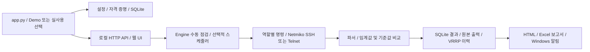

# Netcheck Center 분석 및 독립 이전

검토일: 2026-10-22. 원본은 `yejin0414/test_auto`의
`67445ed5646e699c34fcdd87b3275ed7dee6bfb1`입니다. 원본에는 커밋/Push하지 않았습니다.
대상은 `yejin0414/auto_network`이며 원본 Git 이력 없이 검토된 파일로 시작합니다.

## 실행 구조

- `app.py`는 설정·저장소·Engine을 구성합니다. `--demo`는 `DemoWorld`를 사용하며 실제 장비에 접속하지 않습니다.
- `nc/commands.py`는 BB(Comware), MM 및 WLC(ArubaOS 8) 명령과 대체 명령을 정의합니다.
  `nc/collector.py`는 Netmiko 연결, 인증 오류 구분, 명령 응답 및 연결 종료를 처리합니다.
- `nc/engine.py`는 장비 병렬 수집, 클러스터 대표 선택, 기준값·변화 이력·보관 기간을 관리합니다.
  스케줄은 프로세스 내부 스레드와 선택적인 Windows 작업 스케줄러로 나뉩니다.
- `nc/parsers.py`와 `nc/evaluate.py`는 CPU/메모리, 슬롯·전원·팬, 인터페이스, LACP,
  OSPF, VRRP, MM 상태, WLC 멤버십·Client 분배를 해석합니다. 정상/주의/장애/확인 불가를 구분합니다.
- `nc/server.py`는 루프백 HTTP 서버와 토큰 인증 API를 제공합니다. 웹은 외부 CDN 없이 동작하는 HTML/CSS/JS입니다.
- `nc/store.py`는 WAL 모드 SQLite에 점검 회차, 결과, 압축 원본 응답, 기준값, 이벤트, VRRP 이력을 저장합니다.
  SQL 값은 바인딩되며 쓰기에는 잠금과 트랜잭션을 사용합니다.
- `nc/report.py`는 HTML, `nc/excel.py`는 Excel을 만듭니다. `appwindow`, `instance`, `wintask`,
  `credentials`, `notify`는 Windows 창·중복 실행·예약작업·자격 증명·알림을 담당합니다.

## 기능별 판정

여기서 **정상**은 코드 검토와 명시한 Demo/fixture/Mock 테스트 범위의 판정입니다.
실제 운영 장비나 회사망에서의 정상 동작을 의미하지 않습니다.

| 기능 | 원본 판정 | 이전본 처리 및 근거 |
|---|---|---|
| Python 구성·실행 흐름 | 정상 / 개선 필요 | 모듈 분리와 실행 흐름 유지. 1회 점검 실패 종료코드 수정 |
| Comware SSH/Telnet | 정상 / 추가 검증 필요 | 루프백 Mock의 실제 Netmiko 경로 유지. 펌웨어별 실장비는 미실행 |
| Aruba MM/WLC SSH | 정상 / 오류 가능성 | CPU·메모리·클러스터 fixture 유지, 수집 누락의 정상 오판 수정 |
| 명령 안전성 | 오류 가능성 P1 | 추가 명령 입력과 실행 직전 모두 조회 명령 검사 |
| 파싱·상태·임계값 | 오류 가능성 P1 | 0 메모리, 불명 전원 상태, NaN/무한대/범위 오류 처리 |
| 웹 UI/API | 정상 / 개선 필요 | 구성도·이력·설정·콘솔 유지. 요청 길이 오류 방어, 예시 IP 교체. 접근성·모바일 E2E 후속 |
| SQLite·HTML 보고서 | 정상 / 추가 검증 필요 | 기존 저장·이력·VRRP 테스트 유지. 장기 DB 크기·장애복구 후속 |
| Excel 보고서 | 오류 가능성 P1/P2 | 수식 주입 방어, 미확인 지표 정상 표시 수정, 회차별 파일명 |
| 자동 스케줄러 | 개선 필요 P1 | 신규 설정 기본 꺼짐, 원본과 작업 이름 분리. 사용자가 켠 경우 기능 유지 |
| 테스트·Actions·EXE | 개선 필요 | macOS와 Windows 결과 구분, Windows 3.12 러너 유지, 자동 Release 제거 |

## 재현한 문제와 수정

P1은 잘못된 명령·상태 판정 또는 원본 환경에 영향을 줄 수 있는 문제,
P2는 운영 편의·진단·일부 이력 정확성 문제입니다. 재현에는 순수 함수, Mock 또는 폐기 가능한 CI만 사용했습니다.

| ID / 우선순위 | 원본 재현 및 영향 | 수정 / 회귀 검증 |
|---|---|---|
| F01 P1 | `extra_commands.BB`에 `reboot` 또는 개행을 넣으면 `validate`와 `commands_for`를 통과. 자동 점검 경로가 설정 명령을 전송할 수 있음 | `config`, `commands`, `collector.run_spec`에서 공통 검사. 제어문자·리디렉션·비조회 파이프 차단. Mock의 `session.run` 미호출 확인 |
| F02 P1 | 원본/대상 모두 `NetcheckCenter` 계정 서비스·인스턴스와 같은 예약작업 사용. 실행만으로 기존 설정 덮어쓰기·종료 가능 | 서비스/상태 `AutoNetwork.NetcheckCenter`, 작업 `AutoNetwork NetcheckCenter AutoCheck`, 포트 8875/8876. 원본 앱을 인식해 강제 종료하는 경로 제거 |
| F03 P1 | Demo/단위테스트의 `CredentialStore.set(..., remember=False)`가 OS 저장 계정 삭제 경로에 진입 | `persistent=False`에서 OS keyring 발견·읽기·쓰기·삭제 모두 금지. Demo/일반 테스트에 적용 |
| F04 P1 | WLC CPU/메모리 성공, membership/load 실패 시 검사를 생략하여 정상 가능 | 누락·실패·해석 불가 및 상태 없는 멤버는 `unknown`. 정상 fixture도 별도 보존 검증 |
| F05 P1 | `Slot Total Free\n1 0 0` 메모리 출력에서 TypeError로 회차 실패 | 0/불합리/비유한 수치를 제외하고 값이 없으면 확인 불가. 정상 슬롯은 유지 |
| F06 P1 | `cpu_warn=NaN` 등은 float 변환만 통과해 비교가 무효화됨 | 유한값·0~100·주의<장애 및 Client 최소 수 정수 검증 |
| F07 P1 | 장비명·응답 `=1+1`을 Excel에 넣으면 수식 셀로 저장 | 외부 문자열을 명시적 문자열 셀로 저장. 다시 로드해 수식이 아님을 확인 |
| F08 P1 | Excel 컨트롤러 시트에서 CPU/메모리 없는 항목을 정상으로 표시 | 누락 지표 `unknown` 처리 |
| F09 P2 | SSH 배너 직후 EOF에서 빈 recv를 반복하여 접속 진단 종료 안 됨 | EOF·짧은 KEXINIT·비정상 길이 검사, 소켓 종료 확인 |
| F10 P2 | 전원 `Off`/`NotSupply`를 정상·미장착으로 설명 | 제조사 의미를 임의로 단정하지 않고 `unknown` 및 원문 제공 |
| F11 P2 | 같은 분에 2회 보고서를 만들면 파일명이 같아 덮어씀 | 초와 회차 ID를 파일명에 포함 |
| F12 P2 | `_after_run`의 Excel 저장 오류를 즉시 빈 문자열로 덮어씀 | 보고서 처리 전에 이전 오류를 지워 새 실패가 화면에 남음 |
| F13 P2 | `--check-once`가 실패해도 exit 0, 이전 회차를 출력할 수 있음 | 실패 시 exit 1, 반환된 회차가 있을 때만 결과 조회 |
| F14 P1 | 원본 CI는 main Push마다 contents:write로 Release 생성·덮어쓰기 | 읽기 권한 CI와 검증 artifact만 유지. Release 명령 및 태그 생성 없음 |
| F15 P2 | 소스의 배치 파일 4개에 실제 개행 대신 문자 `\\r\\n` 포함 | CRLF로 복구, Git 속성에 배치 CRLF 명시 |
| F16 P2 | 배포 루트로 복사한 autostart 스크립트가 상위 폴더를 앱 위치로 계산 | 소스 tools/와 배포 루트 모두 식별. Windows 실제 바로가기 경로 테스트 |
| F17 P2 | HTTP Content-Length 음수/문자 입력 시 요청이 잘못 처리됨 | 400 응답, 과대 요청 413 유지 |

주요 회귀 테스트: `tests/test_collection_regressions.py`, `tests/test_app_regressions.py`,
`tests/test_windows_build_tools.py`. 기존 E2E는 실제 Netmiko로 루프백 SSH/Telnet Mock에 연결합니다.

## 이전·보안 점검

- 원본 `.git`을 복사하지 않고 소스 스냅샷을 새 저장소로 초기화했습니다. 원본 출처·저작권은 `UPSTREAM.md` 및 기존 파일에 보존합니다.
- 원본 `release/netcheck_center_source.zip`은 중복/중첩 파일 및 미검토 데이터 반입을 막기 위해 제외했습니다.
- 운영 `config/config.json`, DB, 실행 로그, 보고서, 비밀키, 환경 파일은 이전 대상에서 제외하고 `.gitignore`를 보강했습니다.
- Demo·fixture·UI에 남은 사설 IPv4 예시를 문서용 주소로 교체했습니다. 장비명은 BB/MM/WLC 등 일반 예시입니다.
  OSPF Area ID와 펌웨어 버전은 주소로 오인하지 않았습니다. Mock 계정 `op/pw`, `demo/demo`는 테스트 전용입니다.
- Gitleaks 8.30.1로 스냅샷의 알려진 비밀값 패턴을 검사합니다. `tools/check_snapshot.py`는 추적 파일의 운영 데이터·비밀 파일·사설 주소·예상 밖 바이너리를 거부하며 CI에도 적용합니다.
- README의 소스·CI·릴리스 주소는 대상 저장소로 변경했습니다. 아직 게시하지 않은 EXE Release를 다운로드 가능하다고 표시하지 않습니다.
- 대상 Push 권한과 빈 refs를 조회했고 업로드 직전 다시 확인합니다. Force Push는 사용하지 않습니다.
- Windows 전용 통합 테스트는 `NC_WINDOWS_TESTS_DISPOSABLE=1`인 폐기 가능한 러너에서만 실행합니다. 로컬 Mac에서는 예약작업·실장비를 실행하지 않았습니다.

## 검증 기록

기본 명령: `python -m unittest discover -s tests -t . -v`

| 검사 | 상태 / 범위 |
|---|---|
| 원본 스냅샷 기준 테스트 | PASS — macOS, Python 3.12.14, 55개, 113.345초. 별도 baseline 디렉터리와 OS keyring 없는 venv |
| 이전본 전체 테스트 | PASS — macOS Python 3.12.14, 92개 실행: 90개 통과, Windows 전용 2개 미실행, 113.876초 |
| Gitleaks / 소스 파일 검사 | PASS — Gitleaks 8.30.1 비밀값 패턴 발견 0건; 추적 파일 검사 통과 (업로드 직전 재검사) |
| Windows unittest / EXE / 창 / 자격 증명 / 작업 스케줄러 | 대상 저장소에 올라간 정확한 SHA의 Actions 성공으로만 판정. 최초 커밋 작성 시에는 NOT_RUN |
| 실제 장비·회사망·관리자 설치·재부팅·장기 운영 | NOT_RUN — 사용자 요청에 따라 실제 장비 접속·설정 변경 금지 |

원본 SHA의 Windows CI 성공은 참고 이력이며 **수정한 대상의 Windows 검증을 대신하지 않습니다**.
최초 대상 CI [39743482500](https://github.com/yejin0414/auto_network/actions/runs/39743482500)는
92개 중 91개 통과, 1개 실패했습니다. 자동 시작 경로 테스트가 Windows의 `RUNNER~1` 별칭과
긴 경로를 문자열로 비교한 문제였으며, 파일/디렉터리 실제 동일성 검사로 수정했습니다.
초기 실패 실행은 EXE 빌드와 배포를 진행하지 않았습니다. 수정은 별도 브랜치와 PR로 관리합니다.
대상 결과는 [Windows Actions](https://github.com/yejin0414/auto_network/actions/workflows/build-exe.yml)에서 확인합니다.
Windows CI는 원래의 `windows-latest` / Python `3.12`를 유지하며 공개 Release를 만들지 않습니다.

## 남은 개선 과제

| 우선순위 | 과제 / 재현 근거 / 검증 방법 |
|---|---|
| P2 | VRRP 기준에 두 그룹이 있다가 한 그룹이 출력에서 사라져도 남은 그룹만 정상 판정 가능 (`evaluate.eval_backbone`). 그룹 소실 fixture와 의도적 구성변경 구분 필요 |
| P2 | 같은 VRID를 다른 VLAN에서 쓸 때 `_vrrp_rows`가 VRID·새 역할로만 로그를 골라 다른 VLAN 시각을 연결할 수 있음. 인터페이스까지 매칭하는 회귀 필요 |
| P2 | 클러스터 대체 수집은 membership 또는 load 하나 성공 시 재시도를 끝내고 대체 경로의 전체 deadline/holder가 없음. 실패 분류는 개선했지만 부분 성공 조합·전체 시간 예산은 후속 설계 필요 |
| P2 | 과거 Excel 재생성에 현재 임계값을 사용하여 요약/상세 판단이 달라질 수 있음. 회차에 설정·파서 버전 snapshot 저장 필요 |
| P2 | UI에서 계정 저장 후 설정 저장이 실패하면 계정만 바뀔 수 있음. 사전 전체 검증과 실패 시 복구 필요 |
| P2 | 빠른 스케줄 설정 변경에서 동기화 스레드가 역순 완료할 가능성. 단일 큐/잠금 및 마지막 설정 재확인 필요(추가 검증) |
| P2 | 선택 명령의 미구성과 해석 실패 구분 강화. 슬롯/LACP/VRRP 미해석 출력이 검사에서 빠지는 경로에 fixture 필요 |
| P2 | 장비 추가·삭제 후 기준값 정리, SQLite 장기 크기·복구·백업, 디스크 가득 참 등 저장 장애 검증 |
| P2 | 브라우저 접근성·키보드·작은 화면, 비정상 API 값과 동시 설정 변경의 통합 검증 확대 |
| P2 | 의존성 상한·재현 가능한 잠금·공급망 점검, Actions SHA 고정, 별도 승인 기반 릴리스 프로세스 |
| 추가 검증 | Comware/Aruba 펌웨어·SSH 알고리즘별 실제 출력 및 타임아웃. 실장비 명령은 별도 승인 범위에서만 수행 |
| 추가 검증 | 일반 사용자 Windows PC의 Edge·토스트 실제 표시, 로그인/절전/재부팅·권한 정책. CI 성공을 사용자 PC 관찰로 확대 해석하지 않음 |

이후 변경은 별도 브랜치 → Pull Request → Windows CI 확인 → 병합 순으로 관리합니다.
원본 저장소로의 Push 및 Force Push는 금지합니다.

## 실제 변경 파일 목록

원본 스냅샷과 바이트 비교한 목록입니다. 나머지 소스는 유지했습니다.

| 구분 | 경로 |
|---|---|
| 수정 | `.gitattributes` |
| 수정 | `.github/workflows/build-exe.yml` |
| 수정 | `.gitignore` |
| 수정 | `README.md` |
| 수정 | `app.py` |
| 수정 | `config/config.example.json` |
| 수정 | `nc/appwindow.py` |
| 수정 | `nc/collector.py` |
| 수정 | `nc/commands.py` |
| 수정 | `nc/config.py` |
| 수정 | `nc/credentials.py` |
| 수정 | `nc/demo.py` |
| 수정 | `nc/diagnose.py` |
| 수정 | `nc/engine.py` |
| 수정 | `nc/evaluate.py` |
| 수정 | `nc/excel.py` |
| 수정 | `nc/instance.py` |
| 수정 | `nc/parsers.py` |
| 수정 | `nc/server.py` |
| 수정 | `nc/wintask.py` |
| 제외 | `release/netcheck_center_source.zip` |
| 수정 | `tests/fixtures/comware_interface_brief.txt` |
| 수정 | `tests/fixtures/comware_logbuffer_reverse.txt` |
| 수정 | `tests/fixtures/comware_ospf.txt` |
| 수정 | `tests/fixtures/comware_vrrp.txt` |
| 수정 | `tests/test_account.py` |
| 수정 | `tests/test_backbone_access.py` |
| 수정 | `tests/test_diagnose.py` |
| 수정 | `tests/test_e2e_ssh.py` |
| 수정 | `tests/test_report_window.py` |
| 수정 | `tests/test_schedule.py` |
| 수정 | `tests/test_vrrp_stability.py` |
| 수정 | `tests/windows_exe_check.py` |
| 수정 | `tests/windows_instance_check.py` |
| 수정 | `tests/windows_task_check.py` |
| 수정 | `tests/windows_window_check.py` |
| 수정 | `tools/build_exe.ps1` |
| 수정 | `tools/install_autostart.ps1` |
| 수정 | `web/app.js` |
| 수정 | `web/index.html` |
| 추가 | `UPSTREAM.md` |
| 추가 | `docs/MIGRATION_ANALYSIS.md` |
| 추가 | `tools/check_snapshot.py` |
| 추가 | `tests/test_app_regressions.py` |
| 추가 | `tests/test_collection_regressions.py` |
| 추가 | `tests/test_windows_build_tools.py` |
| 추가 | `tests/windows_test_support.py` |

Demo 브라우저 확인: 종합 상태(14대), IN/OUT 두 클러스터, 설정 화면의 자동 점검/백그라운드 OFF와 Demo keyring 비활성 확인. 콘솔 오류 0건. 이는 기본 화면 확인이며 전체 브라우저 E2E는 아닙니다.
